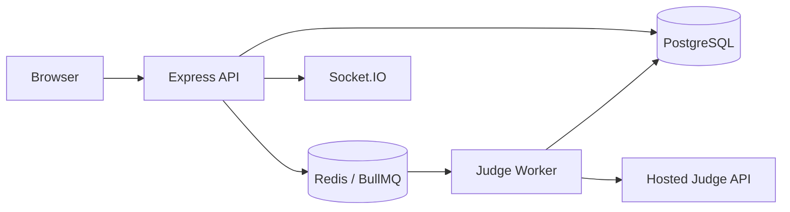

# The Arena — Backend

Node.js + TypeScript API for The Arena. PostgreSQL stores users, contests, problems, test cases, registrations, submissions and audit events. Redis + BullMQ queues judging work. The worker sends each program/test pair to a **hosted Judge0-compatible API**; this repository does not execute untrusted source code on the API host.

## What is implemented

- Email/password registration and login with Argon2id; Google OAuth 2.0 callback.
- Role checks for `PARTICIPANT`, `JUDGE`, `ADMIN`, and `SUPER_ADMIN`.
- Contest discovery, private personal-code gate, idempotent registration, contest/problem visibility rules.
- Organiser API for contests, problems, test cases, publishing, freeze/reveal, join-code rotation, disqualification, audit log and rejudge.
- Async Run and Submit jobs through Redis/BullMQ and a hosted Judge0-compatible API.
- Public-only run tests; hidden test details are not returned to participant responses.
- Exact/token output comparison, all-or-nothing and partial scoring fields, ICPC penalty and leaderboard calculation.
- Health endpoints, rate limits, source hashing and WebSocket room authorization.

## Local setup

Requirements: Node.js 20+, npm, Docker Desktop (only for local PostgreSQL and Redis), and a hosted Judge0-compatible API account/key for code execution.

```bash
cd backend
cp .env.example .env
# Set JWT_SECRET and the hosted Judge0 API credentials in .env
docker compose up -d
npm install
npm run db:push
npm run seed
npm run dev
```

In another terminal:

```bash
cd backend
npm run worker:dev
```

Open `http://localhost:4000`. The API and worker are separate processes. The worker needs access to Redis and outbound HTTPS to the configured judge provider.

The seed script prints random passwords once for `superadmin@demo.local`, `admin@demo.local`, `judge@demo.local`, and `participant1..3@demo.local`. Save them. It seeds a 60-minute `Demo Sprint` with join code `DEMO2026` and six organiser-visible problems with sample/edge test fixtures. Re-running the seed rotates the demo account passwords and restarts the demo contest clock.

## Hosted Judge API configuration

Set `JUDGE0_BASE_URL`, `JUDGE0_API_KEY`, `JUDGE0_HOST`, and the language IDs in `.env`. The defaults are common Judge0 CE language IDs, but verify them against the provider's `/languages` endpoint before a live event. Provider plans have different execution quotas, queue latency and sandbox guarantees. Do not launch a public contest until the provider confirms network isolation, CPU/wall/memory/process/output limits, and the maximum concurrent submissions you need.

`CUSTOM` checkers are represented in the data model but are **not executed by this first backend increment**. Keep those problems unpublished until custom-checker sandbox execution is added. The API also does not yet implement full password reset email delivery, two-factor authentication, data export/deletion, CSV import, problem version pinning, similarity detection, backup automation or the full operational metrics/alerting in the master specification.

## Frontend integration

The frontend calls the API at `/api`. Serve `index.html` from the same origin as this API, or configure a reverse proxy so `/api/*` reaches port 4000. Google OAuth callback must be registered exactly as `GOOGLE_CALLBACK_URL`; `APP_ORIGIN` must be the browser-facing origin. The login/register endpoints return `{ token, user }` and also set an HttpOnly session cookie.

Key endpoints:

- `POST /api/auth/register`, `POST /api/auth/login`, `POST /api/auth/logout`, `GET /api/auth/me`
- `GET /api/contests`, `GET /api/me/contests`, `POST /api/contests/:id/join`
- `GET /api/contests/:id/problems`
- `POST /api/contests/:id/problems/:problemId/run`, `POST .../submit`
- `GET /api/runs/:id`, `GET /api/submissions/:id`, `GET /api/contests/:id/leaderboard`
- Admin endpoints under `/api/admin/*` (Admin/Super Admin policy enforced server-side)

For a closed/private contest, `POST /api/contests/:id/join` requires `{ "personal_code": "..." }`. The plaintext personal code is never stored; only its SHA-256 digest is persisted. The organiser should deliver it to participants privately.

## Tests and build

```bash
npm test
npm run build
```

## Architecture



## Security notes before launch

- Set a long random `JWT_SECRET`; never commit `.env`.
- Use HTTPS and `COOKIE_SECURE=true` in production.
- Restrict `APP_ORIGIN` to the real website origin and configure Google OAuth redirect URI.
- Use a paid/managed PostgreSQL and Redis plan with backups; restrict database/Redis network access.
- Keep the hosted judge API key only in the worker/API environment, never in the browser.
- The API's security controls are a baseline, not evidence that all acceptance/security tests from the complete platform specification have passed. Run the full sandbox escape, IDOR, hidden-test leakage, concurrency and chaos suites before any real competition.